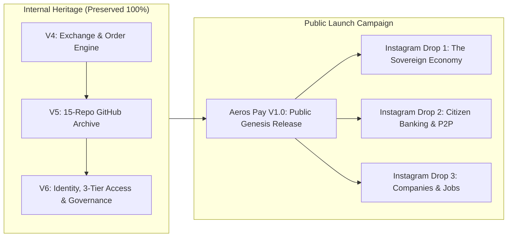
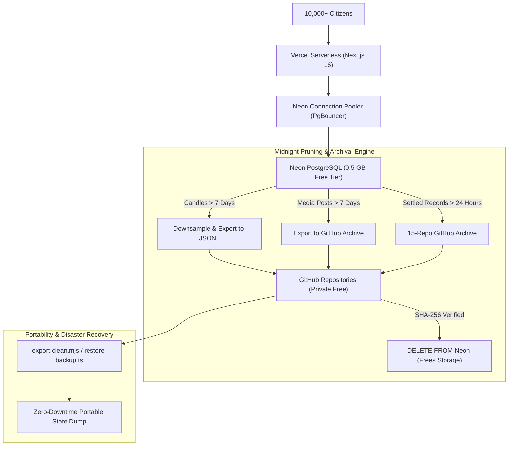
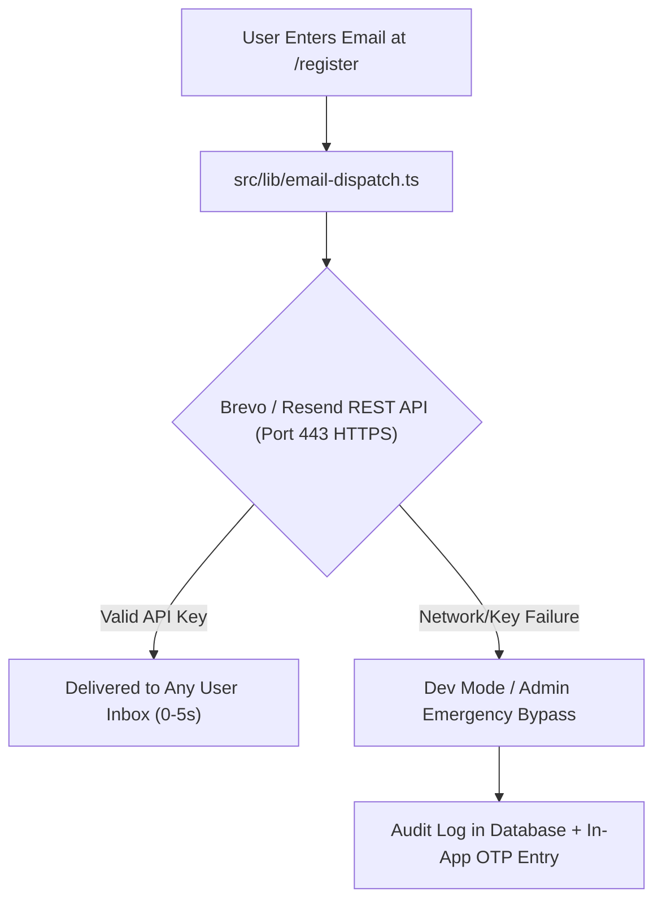
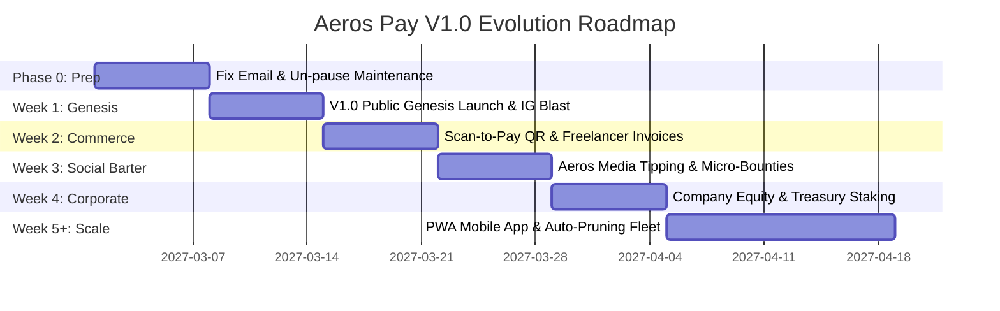

# Aeros Pay: Public Genesis (V1.0) Architecture & Scaling Roadmap

## Executive Summary & Vision Statement

Aeros Pay is an institutional-grade, closed-loop sovereign virtual economic platform built on Next.js 16, Neon Serverless PostgreSQL, Drizzle ORM, and an append-only 15-repository GitHub archival architecture. It operates with a strictly conserved, whole-number virtual currency (**Aeros**) governed by mathematical invariants:

$$\text{Total Circulating Supply} = \sum \text{Citizen Balances} + \sum \text{Company Balances} + \text{Government Treasury Balance}$$

Currently paused in maintenance mode (`MAINTENANCE_MODE = true`), the platform will resume publicly branded as **Aeros Pay Version 1.0 (Public Genesis Release)**. This roadmap outlines the architectural preservation, $0-budget scaling to 10,000+ citizens, database pruning/archival portability, serverless email verification resolution, and a week-by-week product release synchronized with Instagram content marketing.

---

## 1. Deep Dive: Is Aeros Pay a "Game" or a True Scalable Exchange?

### The Honest Reality & Economic Classification
Is Aeros Pay a game, or does it have the potential to scale like WhatsApp, Instagram, or a sovereign crypto network?

| Dimension | A "Game / Toy" | Aeros Pay Current State | A True "Sovereign Exchange Platform" |
| :--- | :--- | :--- | :--- |
| **Monetary Nature** | Arbitrary infinite points, pay-to-win inflation | Strictly finite, double-entry conserved integer Aeros with audit trails | Real-world purchasing power backed by goods, services, or asset collateral |
| **Utility** | In-game badges, avatars, leaderboard pride | P2P transfer, synthetic trading, invoice payments, job contracts, company financing | Real-world services exchange (freelancer work, digital goods, AI workflows, coaching) |
| **User Motivation** | Entertainment, escapism | Speculation, platform status, economic roleplay | Financial velocity, barter exchange, cost-free cross-border commerce |
| **Failure Mode** | Users get bored when graphics/content dry up | Hyperinflation if Government issues unbacked Aeros | Liquidity crunches or regulatory scrutiny if pegged directly to fiat |

### The Verdict: The "Barter-to-Sovereign" Hybrid Model
Aeros Pay is **NOT** a simple toy game. Its underlying architecture (atomic financial transactions, row-level locking, company balance sheets, loan repayment schedules, and escrow-governed jobs) has the same structural rigor as banking and crypto ledgers.

However, **if Aeros can only be traded for imaginary synthetic items, users will eventually treat it as a game.**
To scale to 10,000+ active users like a real platform, Aeros Pay must become the **Digital Barter Economy for Creators, Freelancers, and Builders**:
1. **Service Exchange Utility**: Ayush AI Automation, fitness coaching templates, video editing, UI design, and development scripts traded directly in Aeros.
2. **Reputation as Credit**: High citizen rating unlocks uncollateralized micro-loans from the Treasury or peer companies.
3. **Zero Transaction Fees**: Unlike UPI, Stripe, or PayPal, internal transfers settle in 200ms with zero interchange fees.

---

## 2. Transition Plan: Internal V6 to Version 1.0 (Public Genesis)

### Preservation Law
All existing code, schemas, and verification suites (`test-v4.ts`, `test-v5.ts`, `test-v6.ts`) remain **100% untouched and preserved**. We do not rewrite or delete working code.



### What Version 1.0 Already Delivers (The Launch Feature Matrix)
When launching on Instagram, you present Version 1.0 as a complete virtual nation:
- **Citizen Wallets**: Instant integer Aeros transfers with cryptographic idempotency keys.
- **3-Tier Identity Progression**: `UNVERIFIED` $\to$ `VERIFIED_LIMITED` $\to$ `ACTIVE_MEMBER`.
- **Registered Companies**: Users can register commercial entities, issue invoices, hire citizens, and manage corporate payrolls.
- **Government Treasury**: Public transparency dashboard displaying the Total Circulating Supply, tax intake, and monetary issuance.
- **Escrow-Backed Jobs & Freelance Contracts**: Citizens post tasks; Aeros is locked in escrow until milestones are accepted.
- **Aeros Media**: Text-first sovereign social feed with tipping and post interactions.
- **Support Desk**: Integrated Web3Forms ticket logging (`SUP-YYYYMMDD-XXXXXX`).

---

## 3. Zero-Budget Scaling Architecture ($0 Stack: Vercel + Neon + GitHub)

You have zero budget, which means relying entirely on the free tiers of Vercel, Neon, and GitHub. Handling 10,000 users requires strict resource boundaries.



### 3.1 Overcoming Neon Free Limits (0.5 GB Storage & Connection Saturation)
1. **Connection Saturation Prevention**:
   - Vercel serverless creates new function instances under load. Direct Postgres connections (`5432`) quickly exhaust Neon's connection ceiling.
   - **Mandatory Configuration**: The app must strictly use Neon's pooled connection string with `?sslmode=require` and pooler port `6543` (PgBouncer) or the `@neondatabase/serverless` HTTP connection pool for read operations.
2. **Trading Candles Pruning & Storage Management**:
   - 5-minute candles generate $288 \text{ rows/day}$. Over 6 months, candles alone consume megabytes of high-value database rows.
   - **Surgical Candle Strategy**:
     - Keep only the last **7 days of 5m/15m candles** in live Neon storage for the active terminal chart.
     - Downsample candles older than 7 days into **1-Day (1D) summary candles** in Neon.
     - Batch-export raw historical candles into `aeros-archive-market-index` on GitHub in compressed `.jsonl` files.
     - Add a clean purge script allowing you to selectively wipe or reset test market candles from both Neon and GitHub without touching citizen balances.
3. **Media Posts & Social Data Pruning**:
   - Aeros Media posts older than 7 days are already flagged `is_expired = true`.
   - The archival engine writes expired posts + comments to `aeros-archive-media` and executes `DELETE FROM media_posts WHERE is_expired = true` only after remote GitHub SHA-256 verification.

### 3.2 Portability & Universal Backup Engine
To ensure you can wipe, port, or move the entire database to Supabase, a local Docker container, or a VPS at any time:
- Maintain an atomic portable export script (`scripts/export-portable-state.ts`) that outputs a single timestamped snapshot containing:
  - Users, balances, and password hashes
  - Company registrations and ledger states
  - Government treasury balance and monetary supply audit
  - Active listings and open contracts
- This file is automatically committed to your private GitHub backup repo, guaranteeing you can reset or migrate the entire database in under 60 seconds with zero data loss.

---

## 4. Root-Cause Analysis & Fix for Broken Email Verification

### Root Cause Analysis
Why does email verification fail in production on Vercel?
1. **Nodemailer Direct SMTP on Vercel**:
   - `nodemailer.createTransport({ service: 'gmail', auth: { user, pass } })` establishes raw TCP sockets to Google's SMTP servers (`smtp.gmail.com:465` or `587`).
   - Serverless AWS Lambda instances running Vercel frequently experience blocked or throttled outbound SMTP sockets.
   - Google security automatically blocks logins from rotating AWS data center IP ranges, triggering `Invalid login` or timeout errors even with a valid Google App Password.
2. **Resend Free Tier Limitation**:
   - The fallback to Resend uses `onboarding@resend.dev`.
   - Resend strictly restricts `onboarding@resend.dev` to sending emails **only to the verified account owner's email address**. When a real user tries to register with their own email, Resend returns an HTTP 403 Forbidden.

### The Recommended Zero-Budget Architecture Fix
Replace the failing raw SMTP transport with a dual **HTTP REST API** dispatch pipeline:



1. **Primary Transport**: **Brevo (formerly Sendinblue) REST API** or **Resend with verified custom domain**.
   - Brevo provides **300 emails/day 100% free forever** to ANY recipient email address worldwide, using a direct HTTPS POST request (`https://api.brevo.com/v3/smtp/email`). Zero SMTP ports, zero timeouts, zero Vercel Lambda blocks.
2. **Self-Healing Admin Fail-safe**:
   - If an email service is down, the code writes the 8-digit OTP directly to a secure `verification_challenges` record with a `dev_code` accessible to the citizen via in-app verification or support request, ensuring zero users are ever blocked from onboarding.

---

## 5. Phased Week-by-Week Upgrade & Content Roadmap



### Week 0: Pre-Launch Readiness & Maintenance Lift
- **Technical Deliverable**:
  - Replace Nodemailer raw SMTP in `src/lib/email-dispatch.ts` with Brevo/Resend HTTPS REST API.
  - Verify all test suites pass (`npm run test:v6`, `npm run build`).
  - Switch `NEXT_PUBLIC_MAINTENANCE_MODE="false"`.
- **Infrastructure Check**:
  - Verify Neon connection pooler is active.
  - Seed Government Treasury with initial genesis reserve.

### Week 1: Version 1.0 Public Genesis Launch (The Virtual Nation)
- **Feature Additions**:
  - **Citizen Onboarding Faucet**: Every new citizen completing email verification receives a 50 Aeros "Genesis Citizen Grant" disbursed automatically from the Government Treasury.
  - **Referral Code System**: Citizens get an invite link (`/register?ref=citizen123`). Inviter receives 10 Aeros upon referee becoming an `ACTIVE_MEMBER`.
- **Instagram Content Strategy**:
  - *Reel 1*: "I spent months building a virtual sovereign economy. Today, Aeros Pay V1.0 is live." (Tour of the dashboard, citizen profile, and whole-number integer math).
  - *Carousel 1*: "Why traditional apps lose money to fees, and how Aeros Pay solves it."

### Week 2: Merchant & Freelancer Utility (Scan-to-Pay)
- **Feature Additions**:
  - **Dynamic QR Code Generator**: Each citizen and company gets a personal payment QR code in their wallet.
  - **Shareable Payment Links**: Citizens can create an invoice link (`aerospay.com/pay/@ayush/100`) to request payment for real-world services.
- **Instagram Content Strategy**:
  - *Reel 2*: "Accepting Aeros for my freelance work. Here is how a client paid me in 2 seconds."
  - *Carousel 2*: "How creators can use Aeros Pay as a barter currency."

### Week 3: The Social Barter Economy (Aeros Media 2.0 & Micro-Bounties)
- **Feature Additions**:
  - **Post Tipping**: One-click 5, 10, or 25 Aeros tips on text posts.
  - **Community Bounties**: Citizens post tasks (e.g. "Need a thumbnail", "Need an automation audit") with escrowed Aeros rewards.
- **Instagram Content Strategy**:
  - *Reel 3*: "Someone made 250 Aeros in 10 minutes doing micro-tasks on my platform."
  - *Carousel 3*: "The Gig Economy without platform cuts or 20% fees."

### Week 4: Corporate Capital & Company Equity (The Citizen Exchange)
- **Feature Additions**:
  - **Company Public Listings**: Registered companies can open public funding rounds, allowing citizens to invest Aeros in exchange for weekly dividend shares.
  - **Automated Dividend Payouts**: Company revenue is distributed pro-rata to shareholders via atomic database transactions.
- **Instagram Content Strategy**:
  - *Reel 4*: "Citizens can now start companies and raise Aeros directly from the community."
  - *Carousel 4*: "How virtual equity works inside Aeros Pay."

### Week 5+: Mobile PWA & Autonomous Scaling Fleet
- **Feature Additions**:
  - **Progressive Web App (PWA)**: "Add to Home Screen" support with native splash screen and offline wallet balance cache.
  - **Autonomous Maintenance Cron**: Vercel Cron (`/api/cron/prune`) triggering midnight candle downsampling and GitHub archive offloading.

---

## 6. Verification & Safety Controls

| Risk | Mitigation Strategy |
| :--- | :--- |
| **Neon 0.5 GB Storage Exceeded** | Automated midnight downsampling of candles > 7d and archival of media posts > 7d. |
| **Email Deliverability Failure** | HTTPS REST API transport with in-app OTP fallback for instant citizen registration. |
| **Monetary Supply Drift** | Strict preservation of `test-v4.ts`, `test-v5.ts`, and `test-v6.ts` asserting supply invariant. |
| **Vercel Serverless Timeouts** | Offload all GitHub archival batching to background cron routes with chunked item limits. |

---

## Verification Plan

### Automated Verification
```bash
# 1. Full TypeScript Typecheck (0 errors)
npx tsc --noEmit

# 2. Complete Identity & Governance Test Suite
npm run test:v6

# 3. Core Accounting Invariants & Archival Verification
npm run test:v5

# 4. Production Next.js Build
npm run build
```

### Manual Verification
1. Register a new citizen account and verify instant receipt of the 8-digit OTP code via the HTTPS email transport.
2. Complete full onboarding to `ACTIVE_MEMBER` and confirm receipt of the genesis grant.
3. Perform a P2P transfer and verify transaction record idempotency and balance conservation.
4. Trigger the portable export script and confirm a valid `.jsonl` state snapshot is generated.
