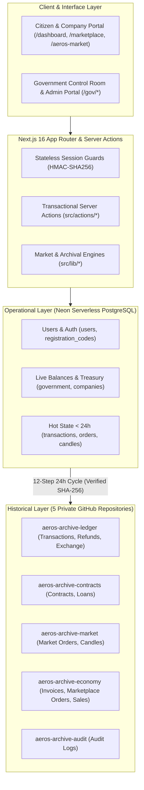

# Aeros Pay — System Architecture

## 1. High-Level Architectural Model

Aeros Pay combines a reactive Next.js 16 App Router interface with a dual-tier storage strategy:
- **Tier 1 (Operational)**: Neon Serverless PostgreSQL storing active state and hot `< 24h` events.
- **Tier 2 (Historical Archival)**: 5 Private GitHub Repositories storing permanent, immutable append-only records across 11 datasets.

---

## 2. Component Topology & Application Routing

### A. Citizen & Corporate Portal (`src/app/(app)/`)
- `/dashboard`: Citizen overview, Aeros Economy Hub, quick transfer/payment access, and economy checklist.
- `/send`, `/pay`: Peer-to-peer transfer forms with transfer tax calculation.
- `/invoices`, `/invoices/[id]`: Citizen invoice review and one-click settlement.
- `/companies`: Directory of approved companies.
- `/my-company/*`: Corporate portal for company founders (invoices, loans, promotions, sale).
- `/marketplace`, `/market/*`: Decentralized goods/services marketplace, milestone contracts, and wanted board with escrow protection.
- `/exchange`: INR-to-Aeros fixed policy acquisitions with immutable policy snapshots.
- `/aeros-market`: Synthetic index trading terminal (5m, 15m, 1h OHLCV charts, BUY, SELL, SHORT, COVER).
- `/refunds`: Citizen refund claim filing and status tracking.
- `/transactions`: Unified ledger with historical GitHub archive retrieval toggle (`?includeArchived=1`).

### B. Government Control Room (`src/app/gov/`)
- `/gov/control-room`: Real-time emergency feature toggles (transfers, marketplace, market, refunds, etc.).
- `/gov/treasury`, `/gov/issuance`: Central treasury monitoring and monetary expansion actions.
- `/gov/tax`: Basis-point tax policies across transfers and company transactions.
- `/gov/users`, `/gov/codes`: User oversight, account freezing/suspension, invite code generation.
- `/gov/loans`: Corporate loan application review, disbursement, and instalment tracking.
- `/gov/contracts`, `/gov/ip`: Dispute arbitration and IP complaint adjudications.
- `/gov/market`: Synthetic market parameter tuning, slippage guards, and short-selling configuration.
- `/gov/refunds`: Virtual refund adjudications and payouts.
- `/gov/archive`: 5-repository GitHub archive monitoring, manual batch creation, and verified ZIP downloads.
- `/gov/retention`, `/gov/health`: Neon database size telemetry and operational retention cleanup.

---

## 3. Financial & Economic Engines

### A. The Synthetic Market Engine (`src/lib/synthetic-market.ts`)
- **Deterministic Pricing**: Computes synthetic market candles using deterministic seeds and historical order volume, preventing arbitrary price jumps on chart refreshes.
- **Anti-Manipulation Bound**: Clamps single-user order price impact within `maxStepChangeBp`.
- **4 Order Modes**:
  1. `BUY`: Buys long units; Aeros transferred from user to Treasury.
  2. `SELL`: Sells long units; Aeros transferred from Treasury to user. If `unitsHeld === 0`, safely routes to `SHORT`.
  3. `SHORT`: Opens short position with $\ge 100\%$ collateral locked in Treasury.
  4. `COVER`: Buys back shorted units; releases pro-rata collateral $\pm$ realized short P&L (clamped at $\ge 0$ to prevent negative user balance).

### B. The 12-Step GitHub Archival Engine (`src/lib/archive.ts`, `src/lib/github-archive.ts`)
- Implements an automated, resumable 12-step cycle to transfer terminal historical records from Neon PostgreSQL to 5 private GitHub repositories.
- Guarantees zero data loss via mandatory remote read-back SHA-256 verification before clearing records from Neon.
- Maintains repository health with automated storage warnings at 400 MB and rotation triggers at 750 MB.
